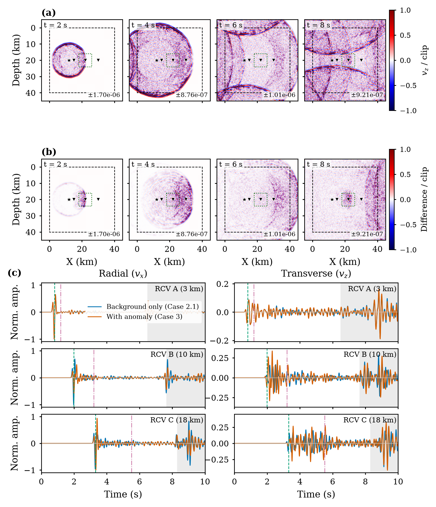
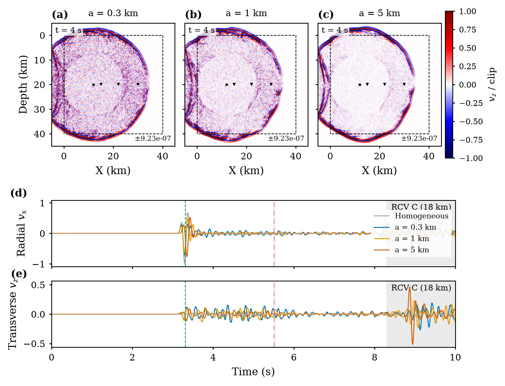
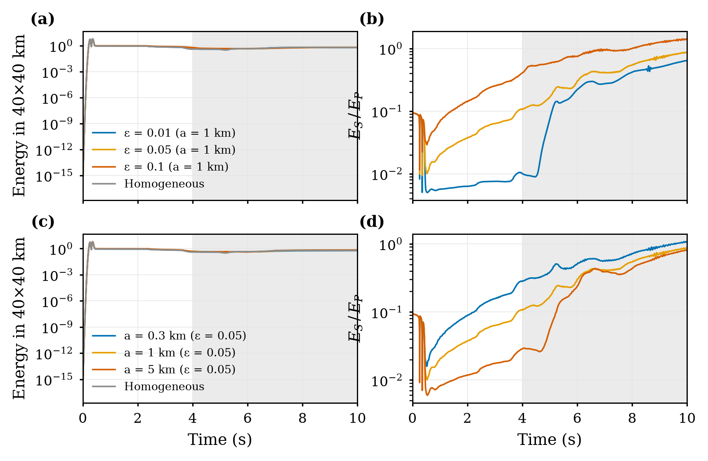
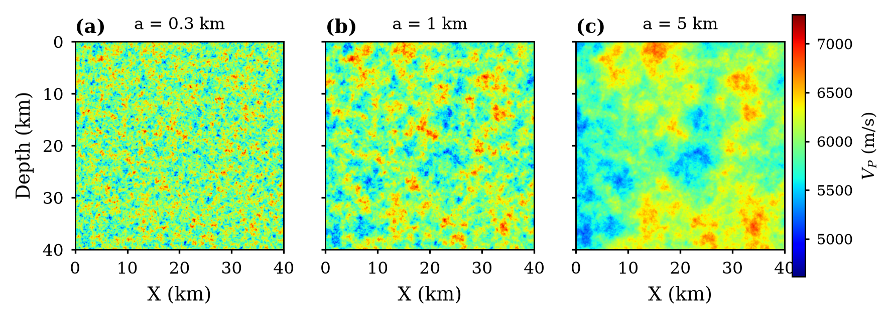
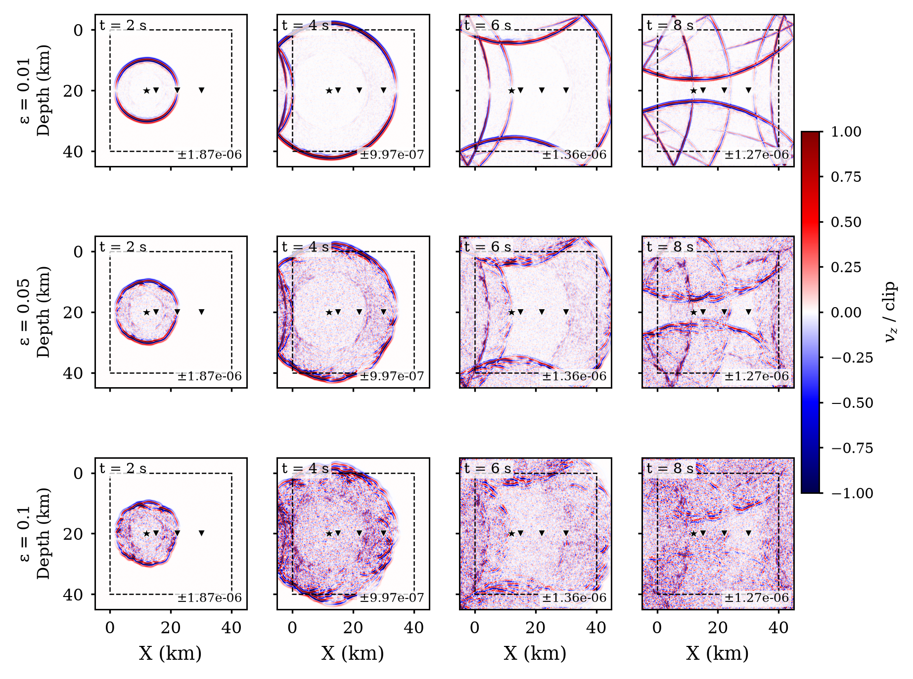
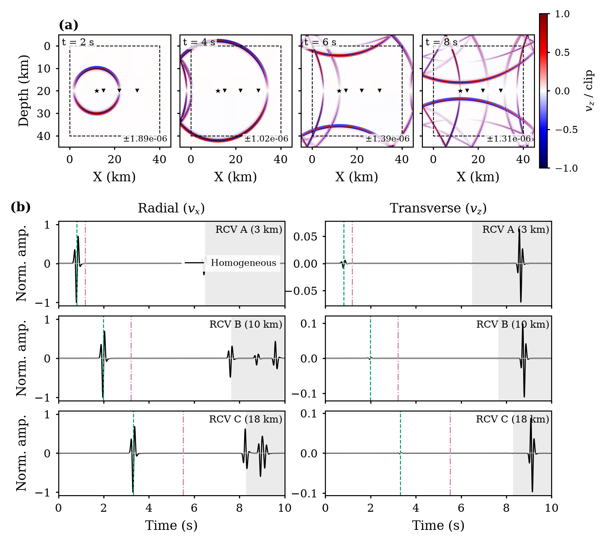
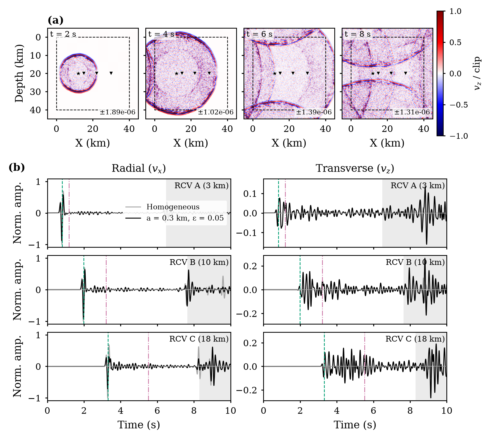
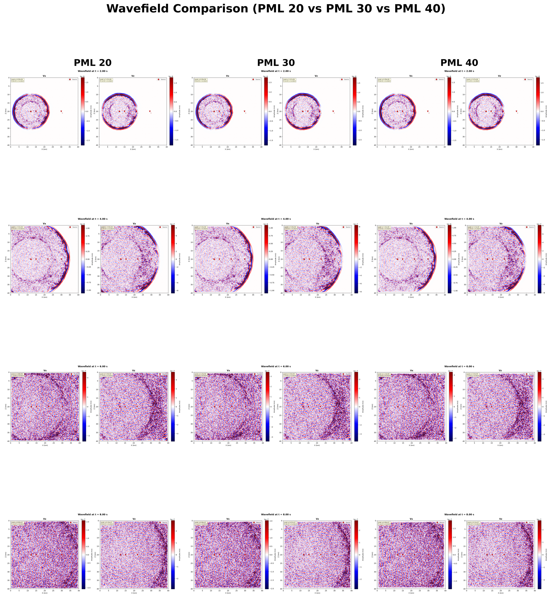

<div align="center">

# Seismic Wave Scattering in Random Heterogeneous Media

**A 2D P-SV elastic finite-difference framework for studying how small-scale crustal heterogeneity and localized scattering anomalies shape seismic wavefields, coda, and P-to-S energy conversion.**

[](https://github.com/mdsabbirhossain90/seismic-model/actions/workflows/ci.yml)


-informational)




<sub><b>Scattering anomaly experiment.</b> (a) v<sub>z</sub> snapshots for a random medium containing an 8 × 8 km strong-scattering box; (b) difference from the same medium without the box, isolating the energy scattered by the anomaly; (c) radial and transverse seismograms at three receivers, with and without the anomaly.</sub>

</div>

---

## Overview

The Earth's crust is not smooth. Velocity fluctuations at scales from hundreds of
metres to kilometres scatter seismic waves: they broaden pulses, delay arrivals,
convert P energy into S energy, and create the long-lasting **coda** that follows
the main arrivals in every earthquake record. This project builds a complete
numerical laboratory to study those effects in a controlled way.

Everything is written from scratch in NumPy:

- a **velocity–stress staggered-grid finite-difference solver** (Virieux, 1986) with
  4th-order spatial accuracy and an optional **convolutional PML (C-PML)**
- a **spectral random-medium generator** with exponential (von Kármán, κ = 0.5) and
  Gaussian autocorrelation, set by the RMS fluctuation **ε** and the correlation
  length **a**
- **embedded scattering anomalies**: a region of stronger heterogeneity inside a
  weaker random background, used to test whether a localized anomaly can be detected
- **wave-type separation** of the wavefield and energy into P (∇·v) and S (∇×v)
  parts, with exact plane-strain strain energy
- a **Monte Carlo radiative-transfer solver** as an independent, energy-based
  model of multiple scattering (Sato, Fehler & Maeda, 2012)
- an automated **analysis pipeline** that turns raw runs into publication-quality
  figures and quantitative metrics (traveltime shifts, amplitude loss, coda/direct
  energy ratios, E<sub>S</sub>/E<sub>P</sub>)

## Key findings

All numbers below come from [`nopml_50km/thesis_figures.py`](nopml_50km/thesis_figures.py)
and are stored in [`docs/data/`](docs/data/).
Source frequency f<sub>0</sub> = 4.78 Hz (P wavelength ≈ 1.26 km); receivers at 3, 10 and 18 km from the source.

**1. Stronger heterogeneity gives a weaker direct wave and a stronger coda.**
At the farthest receiver (18 km, a = 1 km):

| RMS fluctuation ε | Direct-P peak (vs. homogeneous) | P delay | Coda / direct energy |
|:---:|:---:|:---:|:---:|
| 0.01 | 0.98 | +2.9 ms | 0.002 |
| 0.05 | 0.65 | −3.6 ms | 0.067 |
| 0.10 | **0.32** | **+225 ms** | **0.68** |

At ε = 0.10, about two-thirds of the direct-wave amplitude is lost over 18 km, and the
coda carries almost as much energy as the direct arrival.

**2. Scattering strength depends on the scale of the heterogeneity, not only its size.**
At fixed ε = 0.05, changing only the correlation length moves the medium between
scattering regimes (ka ≈ 1.5, 5 and 25):

| Correlation length a | Coda / direct energy (18 km) | E<sub>S</sub>/E<sub>P</sub> at 3 s | P delay at 10 km |
|:---:|:---:|:---:|:---:|
| 0.3 km | **0.195** | **0.157** | +13.7 ms |
| 1 km | 0.067 | 0.063 | +27.6 ms |
| 5 km | 0.014 | 0.018 | **+51.2 ms** |

Small-scale heterogeneity (ka ~ 1) scatters strongly and produces coda and S waves.
Large-scale heterogeneity scatters weakly but delays the wavefront more. This is the
transition from the scattering regime to the travel-time (forward-scattering) regime.

**3. P-to-S conversion is a sensitive indicator of heterogeneity.**
The S/P energy ratio at 3 s rises from 0.005 (homogeneous) to 0.25 at ε = 0.10, a
factor of about 50, while the total energy in the model area changes by only ~15%.

**4. A localized anomaly leaves a measurable fingerprint.**
Adding an 8 × 8 km box with ε = 0.09 to an ε = 0.05 background:

| Receiver | Direct-peak ratio | Late-coda energy ratio | S-energy ratio |
|:---:|:---:|:---:|:---:|
| A, before the box (3 km) | 1.00 | 1.27 | 1.19 |
| B, inside the box (10 km) | **0.59** | 0.94 | **1.55** |
| C, behind the box (18 km) | 1.03 | **1.43** | **1.54** |

Inside the anomaly the direct wave is 41% weaker. The receiver behind it records 43%
more late coda and 54% more S energy, while the direct wave at the receiver in front
is almost unchanged.

## Results gallery

<table>
<tr>
<td width="50%"><br><sub><b>Effect of correlation length</b> (ε = 0.05): wavefields at 4 s and seismograms at 18 km for a = 0.3, 1 and 5 km.</sub></td>
<td width="50%"><br><sub><b>Energy budget:</b> total energy in the 40 × 40 km area and E<sub>S</sub>/E<sub>P</sub> over time for the ε- and a-series.</sub></td>
</tr>
<tr>
<td><br><sub><b>Random velocity models</b> for a = 0.3, 1 and 5 km on a common colour scale.</sub></td>
<td><br><sub><b>ε-series overview:</b> wavefield evolution for ε = 0.01, 0.05 and 0.10.</sub></td>
</tr>
<tr>
<td><br><sub><b>Homogeneous reference:</b> clean P and S wavefronts and seismograms.</sub></td>
<td><br><sub><b>Heterogeneous medium</b> (a = 0.3 km, ε = 0.05) on the same colour scale.</sub></td>
</tr>
</table>

<details>
<summary><b>Absorbing-boundary study (C-PML thickness 20 / 30 / 40 cells)</b></summary>
<br>

</details>

## Numerical method

| Component | Implementation |
|---|---|
| Governing equations | 2D P-SV elastodynamics, velocity–stress formulation |
| Spatial discretization | Staggered grid, 4th-order (C₁ = 9/8, C₂ = −1/24) or 2nd-order |
| Time integration | 2nd-order leap-frog; Δt = 0.6 × CFL limit (CFL factor 6/7 for 4th order) |
| Dispersion control | Automatic points-per-wavelength check (≥ 6 for 4th order); a Vs floor of 1800 m/s keeps PPW ≥ 7.5 |
| Source | Explosive (σ<sub>xx</sub> + σ<sub>zz</sub>) Ricker wavelet, delay t₀ = 1.5/f₀ |
| Boundaries | C-PML with damping d, frequency shift α and grid stretching κ (Komatitsch & Martin, 2007), **or** a 5 km padded domain with rigid walls, analysed only in time windows before the first boundary reflection |
| Random media | FFT filtering of white noise with the target power spectral density, rescaled to the exact RMS ε |
| Diagnostics | Divergence/curl P–S separation; exact plane-strain strain energy; energy in the region of interest vs. the whole domain (conservation check); receiver traces of v<sub>x</sub>, v<sub>z</sub>, P and S |
| Metrics | Cross-correlation traveltime shifts with sub-sample parabolic refinement, direct-wave peaks, coda/direct energy, transverse coda fraction, E<sub>S</sub>/E<sub>P</sub> |

**Verification:** with energy-conserving rigid walls, whole-domain elastic energy stays
constant to within 0.6% over 1–10 s in every case checked, including ε = 0.10 media
with more than 4600 time steps.

The full derivation and design choices are in [`docs/METHODS.md`](docs/METHODS.md).

### Experimental design

| Case | Medium | a | ε | Purpose |
|:---:|---|:---:|:---:|---|
| 1 | Homogeneous (Vp = 6000, Vs = 3464 m/s, ρ = 2700 kg/m³) | — | 0 | Reference |
| 2.1 | Random, exponential PSDF | 0.3 km | 0.05 | Small-scale scattering |
| 2.2 | Random, exponential PSDF | 1 km | 0.05 | Intermediate scale |
| 2.3 | Random, exponential PSDF | 5 km | 0.05 | Large-scale / forward scattering |
| 2.4 | Random, exponential PSDF | 1 km | 0.01 | Weak heterogeneity |
| 2.5 | Random, exponential PSDF | 1 km | 0.10 | Strong heterogeneity |
| 3 | Case 2.1 + 8 × 8 km anomaly box | 0.3 km | 0.05 / 0.09 | Anomaly detectability |

The model area is 40 × 40 km with 50 m grid spacing and 10 s of simulated time. A fixed
random seed (42) makes every case exactly reproducible.

## Repository structure

```
seismic-model/
├── nopml_50km/              # Final research configuration (padded 50 × 50 km grid)
│   ├── model.py             #   Single-run driver (CLI)
│   ├── elastic_solver.py    #   FD solver, P/S separation, energy diagnostics
│   ├── velocity_model.py    #   Random-medium and anomaly generators
│   ├── geometry.py          #   Source–receiver geometry
│   ├── run_sets.py          #   Batch runner with logging
│   ├── compare_sets.py      #   Common-scale comparison figures
│   ├── thesis_figures.py    #   Publication figures + metric tables
│   └── legacy/              #   Earlier model versions kept for traceability
├── pml_model/               # C-PML configuration and earlier experiments
│   ├── model.py, elastic_solver.py, velocity_model.py, geometry.py
│   ├── mc_solver.py         #   Monte Carlo radiative transfer
│   ├── run_all.py           #   Homogeneous vs. heterogeneous batch
│   └── smoke_test.py        #   Fast numerical sanity checks
├── pml_comparison/          # PML thickness study
├── docs/
│   ├── METHODS.md           #   Theory and numerical details
│   ├── figures/             #   Selected result figures
│   └── data/                #   Metric tables (CSV) and their definitions
├── archive/                 # Historical setup script
└── requirements.txt
```

## Getting started

```bash
git clone https://github.com/mdsabbirhossain90/seismic-model.git
cd seismic-model
python -m venv .venv && source .venv/bin/activate
pip install -r requirements.txt
```

**Quick check (about 10 s):**

```bash
cd nopml_50km
python model.py --perturbation 0.05 --corr 6 --t-total 0.3 --snap 0.3 --output-dir results/quick
```

**Reproduce the study:**

```bash
cd nopml_50km
python run_sets.py --quick          # 1-second pipeline test of all sets
python run_sets.py                  # full 10 s runs
python thesis_figures.py            # figures + metric tables
```

**Single runs:**

```bash
python model.py --model homogeneous --output-dir results/homo
python model.py --perturbation 0.10 --corr 20 --output-dir results/eps0.10_a1km
python model.py --anomaly --eps-bg 0.05 --eps-anom 0.09 --corr 6 --output-dir results/anomaly
python model.py --psdf gauss --perturbation 0.05 --corr 6 --output-dir results/gauss
```

| Option | Meaning |
|---|---|
| `--model {homogeneous,heterogeneous}` | Medium type |
| `--psdf {exp,gauss}` | Autocorrelation of the random medium |
| `--perturbation` | RMS velocity fluctuation ε |
| `--corr` | Correlation length in cells of 50 m (6 → 0.3 km, 20 → 1 km, 100 → 5 km) |
| `--anomaly --eps-bg --eps-anom` | Background + anomaly-box mode |
| `--pml`, `--pad-km` | Absorbing-layer thickness / padding around the model area |
| `--order {2,4}`, `--f0`, `--t-total`, `--snap`, `--seed` | Numerics, source, duration, snapshots, reproducibility |

## Outputs of each run

Each run writes velocity models (Vp, Vs), the source–receiver geometry, v<sub>x</sub>/v<sub>z</sub>
and P/S wavefield snapshots, two-component receiver seismograms with predicted P, S and
boundary-reflection markers, P/S/total energy curves, and `.npz` archives of all
traces, snapshots and models for further analysis.

## References

- Virieux, J. (1986). P-SV wave propagation in heterogeneous media: Velocity-stress finite-difference method. *Geophysics*, 51(4), 889–901.
- Levander, A. R. (1988). Fourth-order finite-difference P-SV seismograms. *Geophysics*, 53(11), 1425–1436.
- Komatitsch, D., & Martin, R. (2007). An unsplit convolutional perfectly matched layer improved at grazing incidence for the seismic wave equation. *Geophysics*, 72(5), SM155–SM167.
- Frankel, A., & Clayton, R. W. (1986). Finite difference simulations of seismic scattering. *J. Geophys. Res.*, 91(B6), 6465–6489.
- Sato, H., Fehler, M., & Maeda, T. (2012). *Seismic Wave Propagation and Scattering in the Heterogeneous Earth* (2nd ed.). Springer.

## Author

**[@mdsabbirhossain90](https://github.com/mdsabbirhossain90)**: design, implementation, experiments and analysis.

If you use this code, please cite it via [`CITATION.cff`](CITATION.cff).
